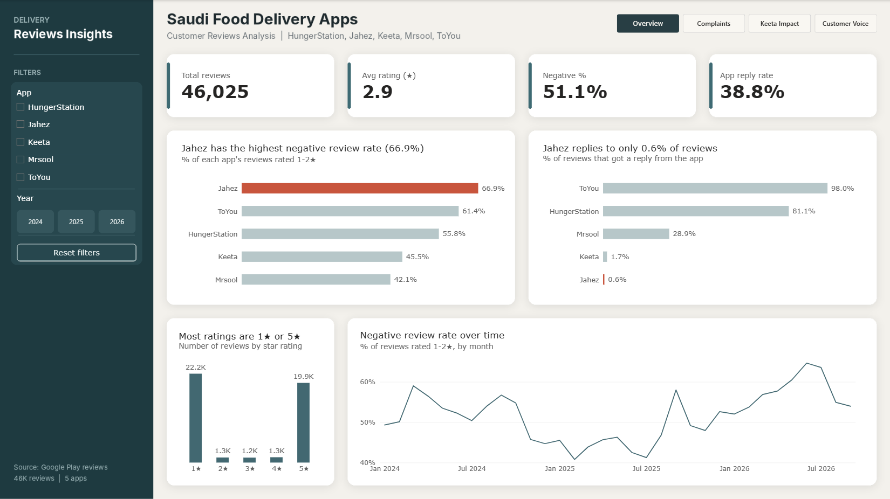
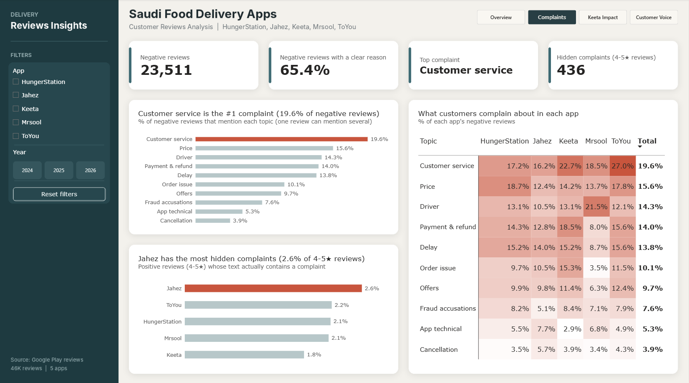
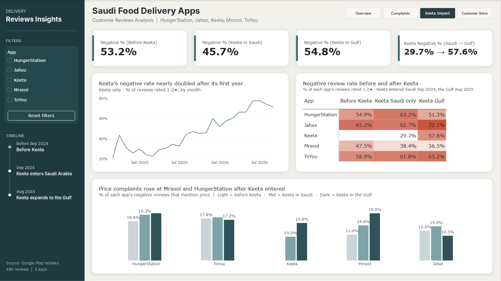
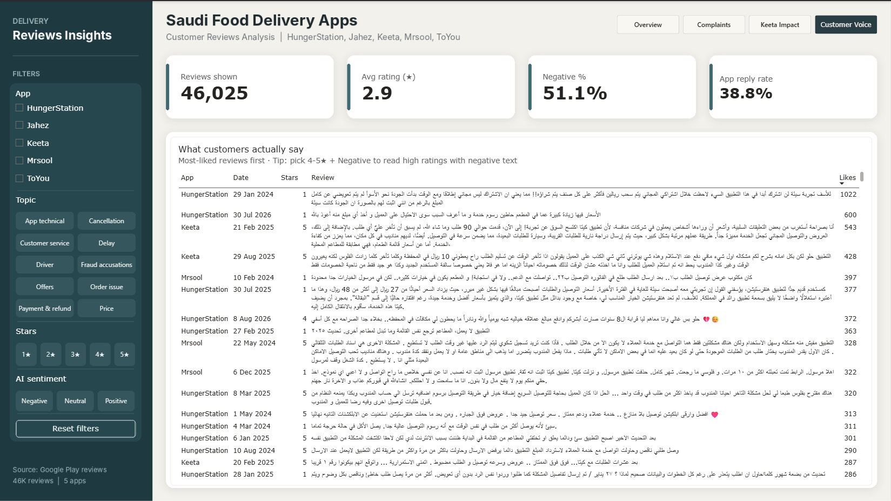

# Saudi Food Delivery Apps: Customer Reviews Analysis

What do customers of Saudi delivery apps complain about, and did the market change after Keeta entered Saudi Arabia in September 2024?

I analyzed **46,025 Arabic Google Play reviews** of five apps: HungerStation, Jahez, Keeta, Mrsool and ToYou (January 2024 to October 2026).

**[Open the live dashboard](https://app.powerbi.com/view?r=eyJrIjoiZDlmZmUzYmQtYThlYS00YjFmLWE3MzYtNjRlM2Y0MmVlNTY5IiwidCI6IjBmZWQwM2EzLTQwMmQtNDYzMy1hOGNkLThiMzA4ODIyMjUzZSIsImMiOjEwfQ%3D%3D)** (interactive, no download needed)



## Key findings

1. **Customer service is the #1 complaint.** 19.6% of negative reviews mention it, ahead of price (15.6%) and the driver (14.3%).
2. **Replying is not the same as solving.** ToYou replies to 98% of its reviews, but it has the highest share of customer service complaints (27%). Jahez replies to only 0.6%.
3. **Keeta's honeymoon ended.** In its first year in Saudi Arabia, 29.7% of Keeta's reviews were negative. After it expanded to the Gulf, that rose to 57.6%.
4. **Price complaints went up at competitors after Keeta entered.** The rise was statistically significant for Mrsool (11.0% to 14.8%, p = 0.0004) and HungerStation (16.6% to 19.3%, p = 0.016). For Jahez and ToYou the change was too small to rule out chance.
5. **Customer service is a deal-breaker, while price is an irritant.** Among 4-5★ reviews whose text is still negative, price is the top complaint (16.1%) and customer service is only 7.6%. Customers put up with high prices, but a bad support experience rarely ends in a high rating.

## Recommendations

1. **Fix customer service first.** It is the top complaint, and it is the one that turns a happy customer into an unhappy one.
2. **Measure solved problems, not reply rate.** A high reply rate did not lower complaints for ToYou. Track whether the customer's problem was actually solved.
3. **Watch price perception when a competitor runs strong offers.** Price complaints rose at Mrsool and HungerStation while Keeta was pushing discounts.

## Dashboard

The Power BI report has 4 pages:

| Page | What it shows |
|---|---|
| Overview | Total reviews, average rating, negative rate and reply rate by app, plus the rating distribution and trend over time |
| Complaints | 10 complaint topics, compared across the five apps |
| Keeta Impact | Negative rate and price complaints before Keeta, during Keeta in Saudi Arabia only, and after Keeta expanded to the Gulf |
| Customer Voice | Real reviews, filtered by app, topic, stars and text sentiment |

| | |
|---|---|
|  |  |
|  | |

## How I did it

| Step | Tool | What I did |
|---|---|---|
| 1. Collect | Python (`google-play-scraper`) | Pulled 63,872 reviews from the Saudi Google Play store |
| 2. Clean | Python (pandas) | Kept Arabic text only, removed Keeta reviews from before its Saudi launch, removed reviews that mention non-Saudi cities or currencies, and dropped user names |
| 3. Classify | Python | Tagged each review with 10 complaint topics using Arabic keyword lists. A manual check of a sample gave about 90% accuracy |
| 4. Store and query | SQL Server | Loaded the clean data and answered the main questions in SQL (`sql/analysis.sql`) |
| 5. Test | Python (scipy) | Used chi-square tests to check whether changes between periods were real or due to chance |
| 6. Text sentiment | Python (CAMeLBERT) | Ran an Arabic dialect sentiment model on all 46,025 reviews to compare the text with the stars |
| 7. Visualize | Power BI | Built a star schema (reviews, apps, dates, topics) with DAX measures and a 4-page report |

## Limitations

- **Google Play reviewers are not all customers.** People who write reviews are usually very happy or very angry: 91% of reviews are 1★ or 5★.
- **Location is not 100% certain.** The store's country filter lets in some reviews from other countries. I kept Arabic only and removed obvious non-Saudi reviews, but some Gulf users may remain, especially in the last period for Keeta.
- **Keyword tagging is about 90% accurate.** Some reviews are tagged wrong or missed.
- **The sentiment model struggles with sarcasm and Saudi slang.** For example, "نجمة وكثيرة عليكم" ("one star is too much for you") is read as positive.
- **Timing is not cause.** The price complaint increase happened at the same time as Keeta's entry, but other things could explain it too.

## Project structure

```
saudi-delivery-reviews/
├── 01_collect_data.ipynb
├── 02_clean_data.ipynb
├── 03_sql_analysis.ipynb
├── 04_statistics.ipynb
├── 05_sentiment_ai.ipynb
├── data.zip            (raw and clean CSV files)
├── sql/
│   └── analysis.sql
├── dashboard/
│   └── delivery_dashboard.pbix
├── images/
├── requirements.txt
└── README.md
```

The data is in `data.zip` because the files are too large for GitHub. Unzip it to get `data/raw/reviews_raw.csv` and `data/clean/reviews_clean.csv`. User names and profile images were removed during collection.

## How to run

1. Install the libraries: `pip install -r requirements.txt`
2. Unzip `data.zip` in the project folder.
3. Run the notebooks in order, from `01` to `05`.
4. Open `dashboard/delivery_dashboard.pbix` in Power BI Desktop to explore the report.

## Tools

Python (pandas, scipy, transformers), SQL Server, Power BI (DAX, star schema)

## Author

Saleh Salem 
